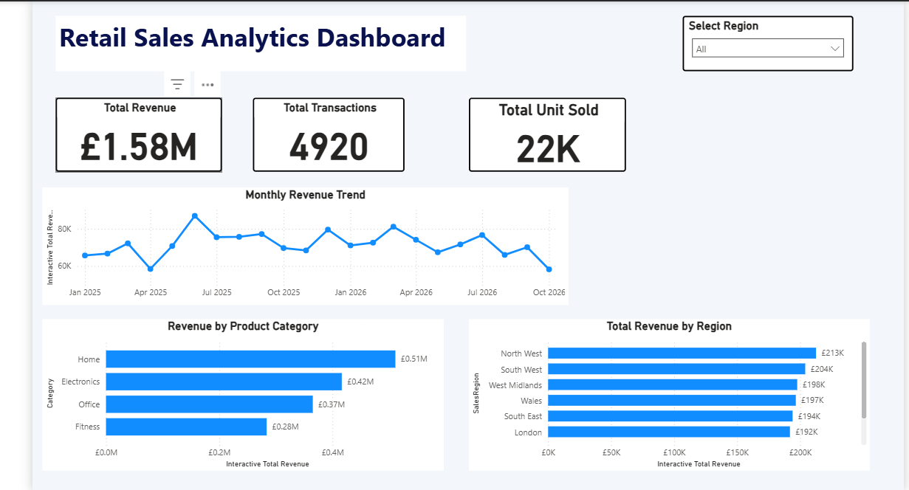
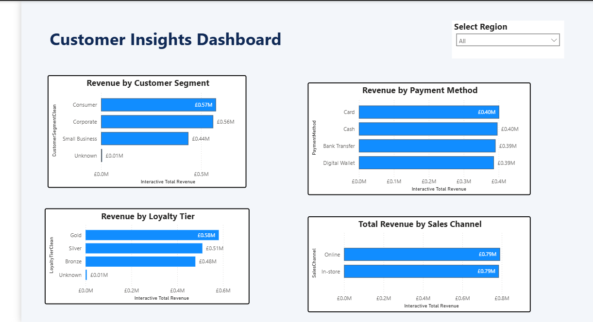

# Azure Retail Sales Data Engineering & Analytics

### End-to-End Azure Data Engineering Portfolio Project

An end-to-end cloud data engineering project that ingests, validates, transforms and analyses retail sales and customer data using Microsoft Azure services.

The solution combines Azure Data Factory, Azure Data Lake Storage Gen2, Azure Synapse Analytics, SQL and Microsoft Power BI to deliver an automated data pipeline and interactive business intelligence dashboards.

> **Project Type:** Data Engineering & Business Intelligence  
> **Cloud Platform:** Microsoft Azure  
> **Dataset:** Synthetic retail sales and customer data  
> **GitHub:** [wivalconcept](https://github.com/wivalconcept)

---

## 1. Project Overview

Retail businesses generate large volumes of transactional and customer data. Without structured data pipelines, organisations can struggle to identify sales trends, monitor data quality and make informed business decisions.

This project demonstrates how to build an end-to-end Azure data engineering solution that transforms raw retail data into validated datasets and actionable business insights.

### Project Objectives

- Ingest retail sales and customer datasets into Azure Data Lake Storage Gen2.
- Orchestrate data movement using Azure Data Factory pipelines within Azure Synapse.
- Implement SQL-based data cleaning and validation.
- Separate valid, rejected and quarantined sales records.
- Enrich sales transactions with customer information.
- Build reusable SQL analytical views.
- Develop interactive Power BI dashboards.
- Document the solution for reproducibility and portfolio presentation.

---

## 2. Technology Stack

| Technology | Purpose |
|------------|---------|
| Azure Data Lake Storage Gen2 | Cloud data storage |
| Azure Data Factory / Synapse Pipelines | ETL orchestration and data movement |
| Azure Synapse Analytics | Serverless SQL querying and transformations |
| SQL | Data validation, cleansing and analytical modelling |
| Power BI | Data visualisation and business intelligence |
| GitHub | Version control and project documentation |

---

## 3. Solution Architecture

The solution follows a layered data engineering architecture.

**Data Flow:**

Raw CSV Data  
↓  
Azure Data Lake Storage Gen2 (Raw Layer)  
↓  
Synapse Pipeline (ADF Activities)  
↓  
Staging Layer  
↓  
Synapse Serverless SQL (Validation & Transformation)  
↓  
Processed / Rejected Data Layers  
↓  
SQL Analytical Views  
↓  
Power BI Dashboards

### Architecture Documentation

[View the Architecture Diagram](architecture/architecture.md)

---

## 4. Data Lake Storage Structure

The project uses Azure Data Lake Storage Gen2 to organise data across multiple processing layers.

```text
retail-project/
├── raw/
├── staging/
├── processed/
└── rejected/
```

### Storage Layers

| Layer | Description |
|-------|-------------|
| Raw | Original retail sales and customer datasets |
| Staging | Intermediate datasets used for processing |
| Processed | Cleaned and validated sales records |
| Rejected | Invalid records identified during validation |

The SQL validation logic also identifies duplicate transactions for quarantine.

---

## 5. Dataset Description

The project uses synthetic retail datasets designed to simulate a real-world business environment.

| Dataset | Records |
|---------|---------|
| Retail Sales | 5,000 |
| Retail Customers | 500 |

### Sales Data

Includes transaction identifiers, customer identifiers, transaction dates, product categories, quantities, prices, discounts, revenue, regions, payment methods and sales channels.

### Customer Data

Includes customer identifiers, customer segments, geographical regions, signup dates and loyalty tiers.

---

## 6. ETL Pipeline

The pipeline is named:

`PL_Retail_Sales_ETL`

It contains four data movement activities:

1. `Copy_Raw_Sales_To_Staging`
2. `Copy_Raw_Customers_To_Staging`
3. `Copy_Clean_Sales_To_Processed`
4. `Copy_Rejected_Sales_To_Rejected`

The pipeline copies source datasets into staging and moves validated and rejected sales records into their respective storage layers.

The cleaning and validation logic is implemented using Synapse serverless SQL views.

### Pipeline Files

[View Pipeline Export](pipeline/)

---

## 7. Data Cleaning and Validation

The project implements SQL-based validation to improve the reliability of retail analytics.

Validation checks include:

- Missing transaction identifiers.
- Invalid transaction dates.
- Invalid quantities.
- Negative prices.
- Invalid discount percentages.
- Invalid transaction amounts.
- Missing sales regions.
- Duplicate transaction identifiers.

### Data Quality Results

| Metric | Records |
|--------|---------|
| Total Sales Records | 5,000 |
| Clean Transactions | 4,920 |
| Rejected Records | 59 |
| Quarantined Records | 21 |
| Total Excluded Records | 80 |

**Clean Data Rate: 98.4%**

The project also identifies 20 clean transactions without matching customer records.

These transactions remain available for sales analysis and are flagged during customer enrichment.

---

## 8. SQL Data Transformation and Analytics

Azure Synapse Analytics serverless SQL is used to query CSV data stored in Azure Data Lake and create reusable analytical views.

### Data Preparation Views

| SQL View | Purpose |
|----------|---------|
| `vw_retail_sales_staging` | Reads staged sales data |
| `vw_retail_customers_staging` | Reads staged customer data |
| `vw_retail_sales_clean` | Validates and cleans sales transactions |
| `vw_retail_sales_rejected` | Identifies invalid and duplicate records |
| `vw_retail_sales_enriched` | Combines sales and customer information |

### Business Analytics Views

| SQL View | Business Insight |
|----------|------------------|
| `vw_revenue_by_region` | Regional sales performance |
| `vw_revenue_by_category` | Product category performance |
| `vw_revenue_by_customer_segment` | Customer segment revenue |
| `vw_revenue_by_loyalty_tier` | Loyalty tier performance |
| `vw_revenue_by_payment_method` | Revenue by payment method |
| `vw_revenue_by_sales_channel` | Online versus in-store performance |
| `vw_monthly_revenue` | Monthly revenue trends |

### SQL Scripts

[Explore SQL Transformations and Analytics](sql/)

---

## 9. Power BI Dashboards

The project includes two interactive Power BI dashboard pages connected to the analytical SQL views.

### Dashboard 1: Retail Sales Overview



The Sales Overview dashboard provides:

- Total revenue.
- Total transactions.
- Total units sold.
- Monthly revenue trends.
- Revenue by product category.
- Revenue by geographical region.
- Interactive regional filtering.

### Dashboard 2: Customer Insights



The Customer Insights dashboard provides:

- Revenue by customer segment.
- Revenue by loyalty tier.
- Revenue by payment method.
- Revenue by sales channel.
- Interactive regional filtering.

---

## 10. Key Project Results

| KPI | Result |
|-----|--------|
| Total Revenue Analysed | £1,576,245.85 |
| Valid Transactions | 4,920 |
| Units Sold | Approximately 22,000 |
| Data Quality Pass Rate | 98.4% |
| Customer Records | 500 |
| Unmatched Customer Transactions | 20 |
| SQL Views Developed | 12 |
| Power BI Report Pages | 2 |

### Business Insights

- Home products generated approximately £0.51 million in revenue.
- Consumer customers contributed approximately £0.57 million.
- Gold loyalty customers generated approximately £0.58 million.
- Online and in-store channels each generated approximately £0.79 million.
- Regional revenue analysis enables comparison across UK regions.
- Monthly trend analysis supports monitoring of sales performance over time.

*All figures are based on synthetic project data and are not actual business results.*

---

## 11. Repository Structure

```text
azure-retail-sales-data-engineering/
├── architecture/
│   └── architecture.md
├── docs/
│   └── Project documentation
├── pipeline/
│   └── Synapse pipeline export files
├── screenshots/
│   ├── sales_overview.png
│   └── customer_insight.png
├── sql/
│   ├── 01_retail_sales_staging.sql
│   ├── 02_retail_sales_clean.sql
│   ├── 03_retail_sales_rejected.sql
│   ├── 04_retail_sales_enriched.sql
│   ├── 05_revenue_by_region.sql
│   ├── 06_revenue_by_category.sql
│   ├── 07_revenue_by_customer_segment.sql
│   ├── 08_revenue_by_loyalty_tier.sql
│   ├── 09_revenue_by_payment_method.sql
│   ├── 10_revenue_by_sales_channel.sql
│   ├── 11_monthly_revenue.sql
│   └── 12_retail_customers_staging.sql
└── README.md
```

---

## 12. Skills Demonstrated

### Data Engineering
- Cloud-based data ingestion.
- ETL pipeline orchestration.
- Data lake architecture.
- Data transformation and cleansing.
- Data quality validation.
- Handling rejected and quarantined records.

### SQL and Analytics
- Azure Synapse serverless SQL.
- OPENROWSET and external data sources.
- SQL views and data type conversions.
- Data validation using TRY_CAST.
- Joins and customer data enrichment.
- Aggregations and business KPI calculations.

### Business Intelligence
- Power BI data modelling.
- DAX measures.
- Interactive dashboards.
- KPI reporting.
- Sales and customer analytics.

### Software Engineering Practices
- GitHub version control.
- Structured project documentation.
- Reusable SQL scripts.
- Architecture documentation.

---

## 13. Project Documentation

Additional project documentation is available in the following directories:

- [Architecture](architecture/)
- [ETL Pipeline](pipeline/)
- [SQL Scripts](sql/)
- [Project Documentation](docs/)
- [Dashboard Screenshots](screenshots/)

---

## 14. Future Improvements

Potential enhancements include:

- Implementing incremental data ingestion.
- Introducing parameterised pipelines.
- Adding automated data quality monitoring.
- Implementing pipeline failure notifications.
- Introducing CI/CD for Azure deployments.
- Evaluating Delta Lake storage formats.
- Adding automated pipeline testing.

---

## 15. Author

**Valentine Chukwunwike**

Data Engineering | Data Analytics | Cloud Computing

GitHub: [github.com/wivalconcept](https://github.com/wivalconcept)

---

**Project Status:** Completed portfolio implementation.

